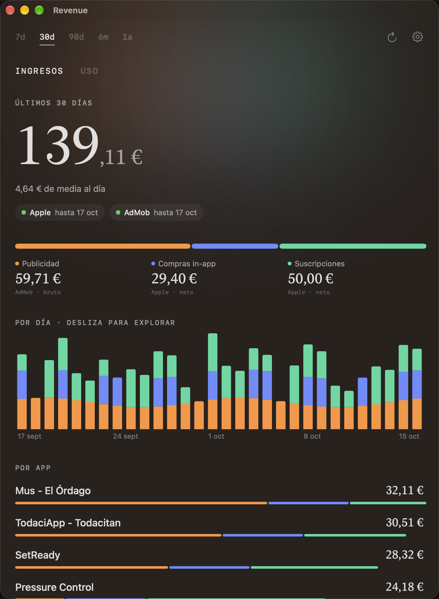

# Revenue Dashboard

A SwiftUI app (iOS and macOS) that brings everything you earn from your apps into a single dashboard, in euros:

- **Apple App Store Connect**: subscriptions, in-app purchases and paid apps (net proceeds, from the daily sales reports).
- **Google AdMob**: advertising revenue (estimated gross).
- **Firebase / Google Analytics 4**: a "Usage" tab with active users, sessions and events per app.

All currencies are converted to EUR using the daily ECB exchange rate.

<p align="center"></p>

> The screenshot uses placeholder data (`-demo` launch argument), not real figures.

## Features

- 7 d, 30 d, 90 d, 6 m and 1 y periods; your choice is remembered between launches.
- Daily chart stacked by source (ads / in-app / subscriptions) and a per-app breakdown.
- Shows how far each provider's data goes.
- On-disk cache for closed Apple reports and exchange rates.
- Credentials are stored in the Keychain; nothing is sent anywhere except Apple, Google and the ECB.

> The UI text is currently in Spanish.

## Project layout

| Folder | Contents |
|---|---|
| `Sources/RevenueKit` | App Store Connect, AdMob and GA4 clients, report parser, ECB conversion, Keychain |
| `App` | SwiftUI interface |
| `Sources/RevenueProbe` | Command-line tool to debug the Apple data |
| `Tests` | Tests written with Swift Testing |

## Getting started

Requirements: Xcode 16+ and [XcodeGen](https://github.com/yonaskolb/XcodeGen) (`brew install xcodegen`).

1. Create your local configuration (git-ignored):
   ```bash
   cp Config/Local.example.xcconfig Config/Local.xcconfig
   ```
   and fill in your bundle ID, Team ID and Google client ID (step 3).
2. Generate the Xcode project and open it:
   ```bash
   xcodegen generate && open RevenueDashboard.xcodeproj
   ```
3. **Google (AdMob and Analytics)**: in the [Google Cloud Console](https://console.cloud.google.com), create an **iOS** OAuth client using your bundle ID and enable the *AdMob*, *Analytics Admin* and *Analytics Data* APIs. Put its client ID in `GOOGLE_CLIENT_ID`. It uses PKCE, so there is no client secret.
4. **Apple**: in App Store Connect go to Users and Access → Integrations and create an API key with access to **Sales** (or Finance). In the app, open Settings and enter the Issuer ID, Key ID and your *vendor number* (Sales and Trends → Reports), then import the `.p8` key.

To preview the design without any credentials, launch the app with the `-demo` argument.

## Notes

- Apple publishes reports with a 1–2 day delay, and AdMob may revise recent amounts.
- Apple figures use *Developer Proceeds* (after commission and taxes), so they differ from the customer price.
- The EUR amount can differ slightly from App Store Connect Trends, which shows the original currency (e.g. USD).
